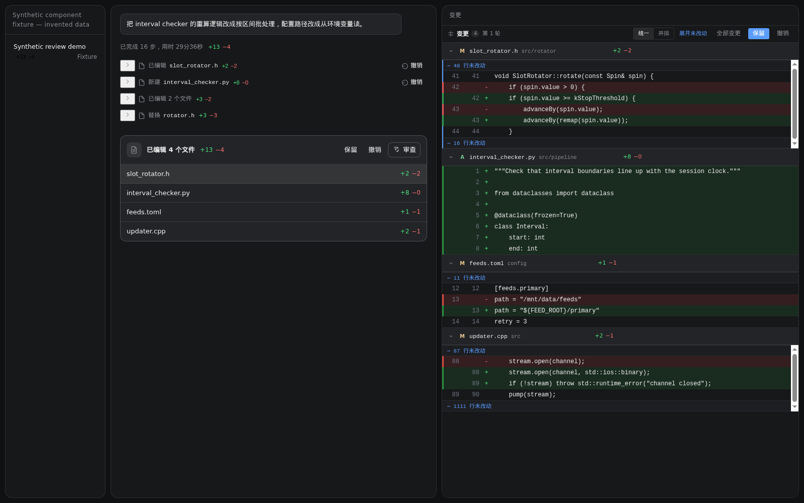
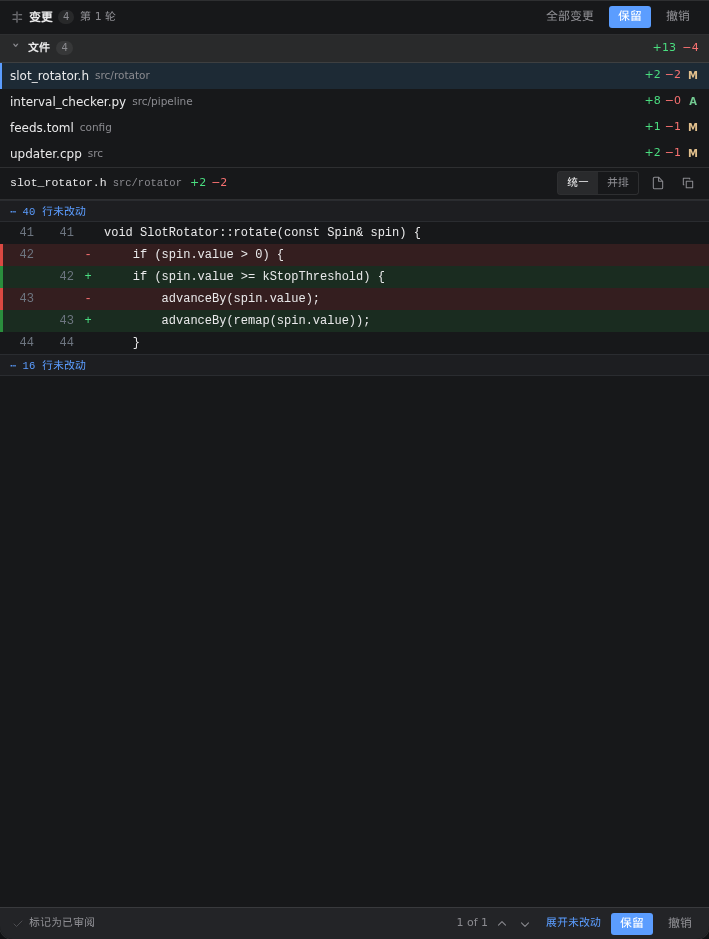
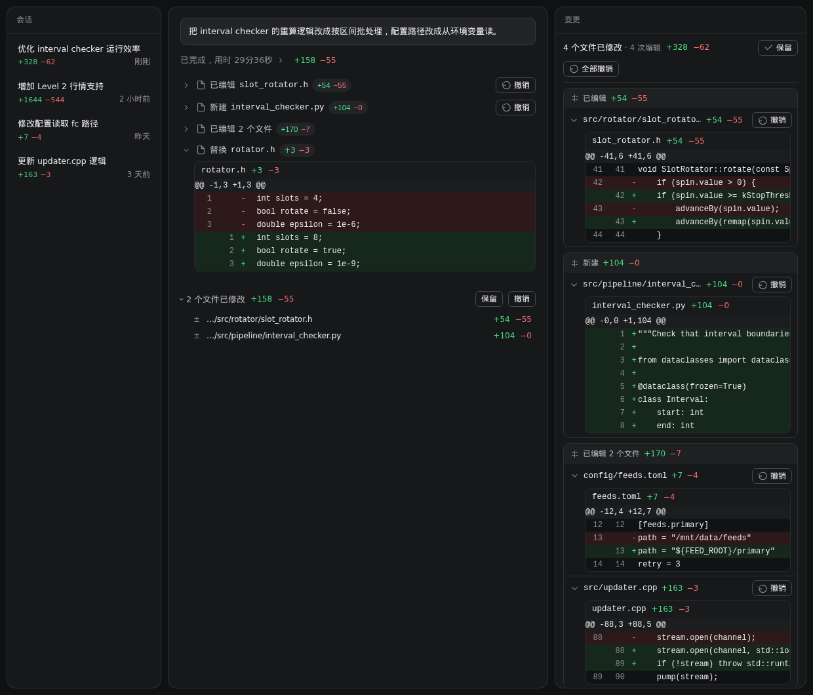

# dsh-copilot-diff

> Copilot 风格的代码审阅：轮末文件列表、点击打开右侧 diff、统一／左右对比、Keep／Undo，以及每轮开始前的 **Restore Checkpoint**。

一个 DeepSeek Harness Web 插件。文件工具保留逐调用 diff；新的逐轮工作区快照按磁盘实际变化识别 `sed`、Python `replace`、脚本及其它命令行修改，提供轮级净改动和持久化检查点。它不调用模型。快照范围和排除项会显示在检查点处；超出覆盖范围的文件不会假装可以恢复。

**0.2.0 新交互**：点击轮末任意文件或增删数字，在右侧打开该轮的审阅视图并选中该文件；可切换统一 diff／左右对比，使用文件选择与上一个／下一个导航。轮次标题前提供 Restore Checkpoint，确认后恢复文件至该轮开始前，包含之后轮次的已记录修改；聊天记录保留。Keep 只表示审阅完成，不删除检查点。旧轮次没有可靠快照时显示不可用。

下方三张截图为早期版本的合成组件示例；当前界面可用 `tools/preview.mjs` 重新生成验证。

默认收起，只留一行摘要；点 `>` 才展开这一处的 diff，点 `+A −R` 直接在右侧审阅面板里定位到它。这一轮的 `+A −R` 就长在助手那句「已完成，用时 11分59秒」后面（替换宿主的 turn-process 行），点数字同样打开右侧审阅面板；每轮末尾再补一行 `N 个文件已修改 +A −R` 与 **保留 / 撤销**：



点开第一条的三角，就是这一处改动的完整补丁（双侧行号、`@@` 块头、增删底色）：





> 第三张图里的 `替换 rotator.h +3 −3` 没有任何服务端记录——它完全是靠调用参数画出来的，这也是被 `dsh-chat-import` 导入的 Copilot 历史会话能显示 diff 的原因。

> 截图由 `tools/preview.mjs` 用本插件真实的组件 + 合成数据渲染出来（`node tools/preview.mjs > docs/preview.html`，浏览器直接打开即可交互），不包含任何真实会话内容。

## 功能

| 能力 | 说明 |
| --- | --- |
| 每次修改自动追踪 | 观察 `edit` / `write` / `apply_patch`，以及编辑器风格的 `replace_string_in_file` / `multi_replace_string_in_file` / `edit_file` / `multi_edit` / `create_file` / `write_to_file`；一次调用 = 一条独立记录（一次改多个文件时按文件各记一条） |
| 换字符串也能看 diff | 这类工具的结果里没有修改前后的全文，所以在调用前先快照目标文件、调用后再读一遍，用两份文本算 diff；连快照都拿不到时（导入的历史记录、绕过工具管线的调用）就直接用参数里的 `oldString` / `newString` 画片段 |
| 行内 diff | 展开后就是完整统一 diff：双侧行号、`@@` 块头、增删底色；超过 12 行折叠为「Show N more lines」 |
| 增删统计 | 动作行右侧常驻 `+A −R`，与 Copilot 的动作行一致 |
| 轮级统计就在「已完成」行 | 轮到 `+A −R` 显示在助手消息开头那行「已完成，用时 …」后面，点击打开右侧审阅面板——与 Copilot 的 action header 位置一致 |
| 默认收起 | 每条记录只占一行摘要，不会把聊天流撑成一片 diff；点行首 `>` 展开 |
| 点开审阅 | 点 `+A −R` 打开右侧审阅面板，并滚动定位到这一次修改 |
| 会话列表统计 | 侧边栏每个会话行下方显示该会话累计的 `+A −R` |
| 审阅面板 | 右侧面板按**时间顺序**（与聊天区一致）列出整轮每个文件，每个文件**默认展开 diff**；顶部是 `N files changed · M edits +X −Y` 与 **Keep / Undo all**；点击任意条目标题行即可收起/展开 |
| 单次撤销 | 每条记录自己的 Undo：只把这一次编辑替换掉的文本写回，不影响同文件的其他编辑 |
| 冲突保护 | 只有当磁盘内容仍等于该次编辑的 `after` 时才写回；否则拒绝，并提示先撤销更新的那次——绝不吞掉后来的改动 |
| 会话累计 | 记录按 session 持久化，重开页面/重连后仍在；面板列出整轮的全部编辑 |
| 历史会话回填 | 插件装上之前发生的修改也能补出 diff：打开一个旧会话时，服务端从该会话自己的 `session.v4.jsonl(.zstd)` 日志里重放 `tool/call` + `tool/result`，把当时改过的文件、增删行数、diff 正文补成同样的记录（状态标为「已保留」，不提供撤销——历史无法诚实回滚）。想看全量统计可以一次性跑 `node tools/backfill.mjs` |
| 零依赖、零构建 | 服务端是纯 ESM，客户端是手写 module-loader bundle，`npm test` 用 `node --test` |

### 与现有三个插件的关系

同类插件各自只覆盖一部分（下表来自这三个插件的官方对比）：

| 能力 | change-review | diff-approval | file-changes | **dsh-copilot-diff** |
| --- | --- | --- | --- | --- |
| 每次修改自动追踪 | 支持 | 支持 | 支持 | **支持** |
| 独立修改记录 | 支持 | 按文件聚合 | 按文件聚合 | **支持（按调用，一次可多文件）** |
| 实时变更面板 | 支持 | 支持 | 轮末展示 | **支持（右侧审阅面板 + 会话行徽标）** |
| 每轮 Diff 汇总 | 支持 | 否 | 支持 | **支持（含 +/− 统计）** |
| 单次修改撤销 | 支持 | 按块撤销 | 否 | **支持（按记录，带冲突保护）** |
| 会话累计审查 | 支持 | 支持 | 否 | **支持** |
| npm 发布 | 否 | 是 | 未确认 | **是（`dsh-copilot-diff`）** |

可以单独用，也可以和 `diff-approval` 同时装：后者管「改之前/之后」的审批，本插件管「改完了，摊开给你看、能一条条撤回」。两者都占 `tool.call.toolview` 的同一个 key 时，后注册的那一个生效；若只想保留其中一个，卸载另一个即可。

## 安装

```bash
# 从 npm（推荐）
dsh plugin --profile web add dsh-copilot-diff

# 直接从 GitHub 装（pnpm 支持 git 依赖）
dsh plugin --profile web add github:huieric/dsh-copilot-diff

# 或先 clone，再从本地目录装
git clone https://github.com/huieric/dsh-copilot-diff.git
dsh plugin --profile web add ./dsh-copilot-diff

# 然后重启 web
dsh web
```

插件自带 `cordis.patch.yml`（`dsh.bundle.patch`），装进 profile 后会自动插入自身的插件行，无需手改配置。

### 装不上时

两个真实踩过的坑：

1. **`ERR_PNPM_STORE_DIR_OPEN_OPERATION_LOCK … /run/user/<uid>/pnpm-store-operation-locks-*/all-stores.lock: Permission denied`**
   pnpm 把 store 的操作锁放在 `$XDG_RUNTIME_DIR` 下；该目录不可写（容器、systemd 用户会话异常、或命令跑在受限沙箱里）时安装会直接失败。把锁指到可写目录即可：

   ```bash
   XDG_RUNTIME_DIR="$HOME/.run" dsh plugin --profile web add dsh-copilot-diff
   ```

2. **装完不生效 / 启动摘要里 `copilot-diff (dsh-copilot-diff): …` 之后整条消失**
   看 `dsh` 启动摘要里的 "did not activate" 一行，它写明了原因。`0.1.0` 曾漏声明 `webServer` 服务（`cannot get property "webServer" without inject`），`0.1.1` 已修复——升级即可。

完全不依赖 pnpm 的安装方式（离线可用：复制文件 + 注册 bundle）：

```bash
./scripts/install-local.sh          # 装进 web profile
./scripts/install-local.sh --remove # 卸载
```

## 和 Copilot 对齐的三处

| 位置 | 长什么样 | 点它 |
| --- | --- | --- |
| 轮次头 | `已完成，用时 29分36秒  +158 −55` | 数字 → 右侧审阅面板（并定位到这轮第一条改动） |
| 轮次内 | 每改一个文件一行：`已编辑 src/rotator/slot_rotator.h  +54 −55` | 行 → 面板里定位到这次改动的 diff |
| 轮末 | `4 个文件已修改  +328 −62` ＋ 逐文件 `+/−` 列表 ＋ **保留 / 撤销** | 文件名 → 右侧审阅该轮该文件的 diff |

三处都只在这一轮确实改过文件时出现。

## 使用

- **看**：每条改文件的动作行右侧就是 `+A −R`，行首的 `>` 展开这一次的 diff。点文件名在编辑器打开该文件，点「Show N more lines」展开完整补丁。
- **审阅**：点 `+A −R`，右侧边栏打开审阅面板并按调用分组列出本次会话的全部改动，定位到你点的那一条；面板里可以逐条撤销，也可以保留/回滚全部。
- **撤销一条**：动作行右侧的 `Undo`。它把这次编辑替换掉的原文写回；如果这之后磁盘又被改过（无论谁改的），它会拒绝并说明原因。
- **保留**：审阅面板顶部的 `Keep` 把整轮标记为已看过（不写文件，只是把记录标记为 `kept`，从待审查里移出）。旁边的 `Undo all` 按逆序回滚整轮，跳过有冲突的记录，并在需要时报告哪些没撤成。
- **打开面板**：点动作行的 `+A −R` 打开审阅面板并定位到那一次修改；点侧边栏图标直接打开整轮的审查视图。

### 旧会话里的修改

插件只能记录它加载之后发生的事，所以装之前那些会话原本是空白的。实际上数据一直都在：每个会话的 `~/.dsh/sessions/<workspace>/<session>/session.v4.jsonl(.zstd)` 里存着全部 `tool/call` 与 `tool/result`，其中文件改动大多自带前后文本（`dshFileReview` 元数据里的 `oldText`/`newText`，或 `replace_string_in_file` 参数里的 `oldString`/`newString`）。

- **自动**：打开一个没有记录的旧会话时，服务端会读它自己的日志、补出记录并落盘，一次会话读一次；聊天里的动作行、右侧面板、会话行徽标、轮末页脚同时就有了数字。
- **批量**：想在会话列表第一眼就看到全部数字，可以一次性跑完：

```bash
node tools/backfill.mjs            # 全部会话
node tools/backfill.mjs --dry      # 只报告，不写文件
node tools/backfill.mjs --only=<会话 id 片段> --since=2026-10-01
```

补出来的记录 `state` 是 `kept`：它们是历史，按钮只给「已保留」，不给撤销——旧会话的磁盘内容早就和当时不同了。跑完请重启 `dsh web`，因为运行中的 host 内存里还留着旧副本。

## 通道与存储

服务端注册连接通道 `/copilot-diff`（`authority: trusted-host`），客户端只在**本地**通过它读数据：

| endpoint | 载荷 | 返回 |
| --- | --- | --- |
| `list` | `{ sessionId }` | `{ revision, totals, records[] }`（不含 diff 正文） |
| `summaries` | `{ sessionIds[] }` | `{ sums: { [sessionId]: totals } }`，只含改过文件的会话，供侧边栏徽标批量取数 |
| `detail` | `{ sessionId, callId }` | `{ records[] }`（含 hunks） |
| `keep` | `{ sessionId, id? }` | `{ changed, ...summary }` |
| `keep-all` | `{ sessionId }` | `{ changed, ...summary }` |
| `revert` | `{ sessionId, id }` | summary，或 `error.code = "conflict"` |
| `revert-all` | `{ sessionId }` | `{ reverted, failures[], ...summary }` |
| `clear` | `{ sessionId }` | summary |

记录落盘在 `${DSH_HOME:-~/.dsh}/copilot-diff/sessions/<session>.json`，每 session 最多保留 400 条（超出丢最旧的）。**文件正文会写进这个文件**（撤销要靠它），只是本地数据，不会发到网络。

## 实现要点

- `ctx.on("tools/result", (exec, result) => …)` 里只取 `result.isError === false` 且命中三个文件写入工具的调用；`before === after` 的空改动不入库。
- diff 是手写的：先剥掉公共前后缀，再按「两侧唯一出现的同一行」递归切分，小区域用 LCS（DP 上限 100 万格），都不满足就退化成整段替换——所以超大补丁不会卡住，也不会退化成一屏红色。
- 撤销不做「按块」或「按行」的猜测：整条记录只有 before/after 两个版本，写回前先读盘比对，不一致就拒绝。宁可少撤，不可误撤。

## 已知限制

- 0.2.0 起，新轮次的 shell 改动来自插件自己的有界全文快照，可查看并恢复；工具完成后与轮末会刷新。宿主 `workspace/changes` 和历史 git 回填仍是无可靠全文时的只读兜底。
- 已经跑完的旧轮次：宿主的内存快照已丢，只能用 git 提交回溯（`tools/backfill.mjs` 默认开启，或用 `--no-git` 关掉）。所以「没有提交、又不在 git 仓库里」的 shell 改动无法还原。

### 补全历史轮次

```bash
# 一次性把历史会话的 diff 都补上（工具记录 + git 提交回溯）
npx dsh-copilot-diff 2>/dev/null || node tools/backfill.mjs
# 只看报告不写盘
node tools/backfill.mjs --dry
```

跑完重启 `dsh web`。git 回溯只扫会话工作目录下第一层的仓库（跳过 node_modules/thirdparty 这类目录），所以 `~/某仓库/...` 里的改动能被补上，`/tmp` 里的临时脚本补不上。


- 文件工具逐调用记录与逐轮快照互补。间接 shell 修改只覆盖快照范围内的本地文件；通过 SSH、容器或远程挂载工具修改的另一个执行环境不保证捕获。不会只根据命令文字猜测被改的文件。
- 历史回填依赖会话日志里能拿到前后文本：`apply_patch` 只写补丁、`dshFileReview` 元数据又缺失时，这条调用补不出来。
- 撤销是「整条记录」粒度的；一次 `apply_patch` 里同一文件的多次改动会合成一条记录。
- 记录随 session 走；跨 session 的同一文件改动不会合并计数。
- 本分支为 `0.2.0` 开发版本。仓库中的版本号不代表已发布 npm；请使用本地安装或本次交付的 npm 包。

## 变更记录

- `0.2.0`（本分支）— 持久化逐轮检查点与 shell 实际修改追踪；Restore Checkpoint 回到选中轮开始前；点击文件打开按轮定位的侧栏；完整 diff 加载、统一／左右对比与文件导航；净改动统计、迟到记录刷新和部分失败提示。大文件、非 UTF-8、符号链接及扫描限制明确排除，历史无快照的轮次不提供虚假恢复。

- `0.1.13` — 历史轮次也能有 diff：会话加载（或 `tools/backfill.mjs`）时，如果一轮没有任何工具记录，就用该轮时间窗内的 git 提交重建逐文件 diff（来源标为 git，只读）。这样「用 bash/python 改的文件」的老轮次也能看到数字。
- `0.1.12` — 用宿主每轮的 `workspace/changes` 快照补课：shell 命令（python/`sed`/脚本）改的文件以前完全看不到，现在出现在同一轮的逐文件列表里（来源标为 workspace，只读不可撤销）；已有工具级记录的文件不重复计入。
- `0.1.11` — 没有工作区根目录的会话（导入或回填的历史）也把绝对路径收成 `…/最后三段`，行内不会再被整段路径挤掉。
- `0.1.10` — 三处对齐 Copilot：①「已完成，用时 …」行上的 `+A −R` 可点开侧边面板；② 展开这轮后，每个改动文件占一行（`已编辑 <相对路径> +A −R`，点行直接定位到面板里对应的 diff）；③ 轮末 `N 个文件已修改 +A −R` 旁的文件名默认展开成逐文件 `+/−` 列表，**保留** 恒可点、**撤销** 只在还有未保留记录时可点。工作区根目录由服务端下发，路径显示为相对路径。
- `0.1.11` — 没有工作区根目录的会话（导入或回填的历史）也把绝对路径收成 `…/最后三段`，行内不会再被整段路径挤掉。
- `0.1.10` — 三处对齐 Copilot： 把这轮的 `+A −R` 挪到助手那行「已完成，用时 …」上（替换宿主的 turn-process 节点，保留它的折叠行为与无障碍播报），点数字直接打开右侧审阅面板；轮末页脚只留 `N 个文件已修改 +A −R` 与 **保留 / 撤销**，不再重复步数与用时。

- `0.1.8` — 让回填结果不会被覆盖：同一会话的记录文件可能同时被运行中的 host 和 `tools/backfill.mjs` 写，原来后写的会整文件替换。现在写盘前先比对 mtime，发现自己上次写完之后文件又被别人改过，就按 `callId + path` 把磁盘上的记录合并进来再写（测试里模拟了「外部追加一条记录后再保存」，37 个用例全过）。

- `0.1.7` — 历史回填：旧会话不再空白。新增 `lib/history.js`（从会话日志重放 `tool/call` + `tool/result`，优先用 `dshFileReview` 的 `oldText`/`newText`，退一步用 `replace_string_in_file` 之类的参数对），服务端在第一次打开一个没有记录的旧会话时自动跑一遍并落盘；`tools/backfill.mjs` 可一次补完全部会话（`--dry` / `--only` / `--since`）。顺带把 diff 引擎抽到 `lib/diff.js`，并开始识别 `file_path` / `old_string` / `new_string` 这类 snake_case 参数。测试 28 → 37。

- `0.1.6` — 每轮结束补上 Copilot 式页脚：一行 `已完成 81 步 · 用时 29m 36s +158 −55`，一行 `2 个文件已修改 +158 −55` 加右侧 **保留 / 撤销**。撤销只作用于这一轮（`revert-turn` 按时间窗回写），保留把这一轮的记录标成 kept 不再提供撤销；聊天区没有任何边框盒子，就是两行文字加两个小按钮。
- `0.1.5` — 改名：包名 `dsh-live-diff` → **`dsh-copilot-diff`**（仓库、npm 同步）。插件行 id 变成 `copilot-diff`，连接频道 `/copilot-diff`，客户端 bundle id 与面板 id 一起改；旧的本地记录会自动从 `~/.dsh/live-diff/sessions/` 读一次（只读兼容），之后写到 `~/.dsh/copilot-diff/`。从旧包升级：`dsh plugin --profile web remove dsh-live-diff && dsh plugin --profile web add dsh-copilot-diff`。
- `0.1.4` — 按截图反馈改了三处：① 审阅面板改成**正序**（和聊天区动作行同一顺序，原来是倒序）；② 面板里每个文件**默认展开 diff**，整条标题行都可以点（原来只有一个小三角能点，而且默认收起，看不到内容）；③ **去掉轮末那条汇总横条**（`N files changed · M edits +X −Y` + 查看/保留/全部撤销）——数字已经在面板顶部和会话行徽标里，聊天流里再摆一条是重复的噪音。
- `0.1.3` — 让"换字符串"类调用也能看 diff。新增 `tools/pre-execute` 快照：对 `replace_string_in_file`、`multi_replace_string_in_file`、`edit_file`、`multi_edit`、`create_file`、`write_to_file` 在读参数里列出的文件之前先存一份原文，结果回来后再读一遍算 diff；服务端没有记录时客户端还会用参数里的 `oldString`/`newString`/`content` 现场画片段，所以**导入的历史会话、绕过工具管线的调用、插件热重载中途的调用都有 diff 可看**。toolview 注册键从 3 个扩到 9 个，动词补 `替换`/`Replaced`。

- `0.1.2` — 改成 Copilot 的读法：动作行默认收起，点 `>` 才展开 diff；`+A −R` 变成按钮，点开右侧审阅面板并定位到这次修改；轮末汇总条在收起过程后仍然可见；侧边栏会话行新增该会话累计的 `+A −R` 徽标（新增 `summaries` 批量端点，5 秒一轮，只查可见会话）。顺带修了两个只在真实 locale 下才炸的问题：把回退文案当插值参数传给 `t()`（模板含 `{}` 时 `name in params` 抛错），以及窄面板里按钮文字被挤成竖排。
- `0.1.1` — 修复无法激活：`inject` 漏了 `connection.register` 内部实际依赖的 `webServer`（启动摘要显示 `cannot get property "webServer" without inject`）。测试补了一条守卫，要求声明的服务覆盖真正用到的服务，这类问题从此是测试失败而不是装完静默消失。
- `0.1.0` — 首个版本。

## 开发

```bash
git clone https://github.com/huieric/dsh-copilot-diff.git
cd dsh-copilot-diff
npm test          # diff 引擎、真实文件快照/恢复、服务端、客户端与历史回填
```

- `lib/index.js` — 服务端：diff 引擎、每 session 的 `EditLog`、`/copilot-diff` 通道。
- `lib/client.js` — 客户端：`tool.call.toolview`（9 个工具 key）、`sidebar.right.pane.tab`（`+ .title`）、`sidebar.workspaces.session.row.action` 与 `sidebar.session.row.hover`，手写 bundle，无构建步骤。
- `tools/preview.mjs` — 把 `lib/client.js` 装进一个迷你的 hook 渲染器，用合成数据渲染出 `docs/preview.html`；`docs/screenshots/*.png` 就是它的截图。
- `test/` — `node --test`。

## License

MIT © huieric
