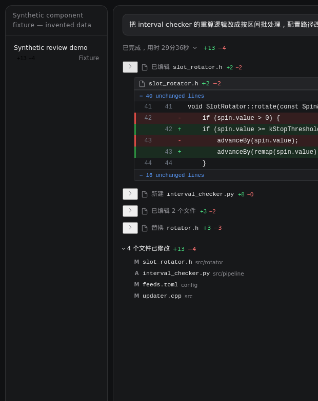

# dsh-copilot-diff

> Copilot 风格的代码审阅：每处编辑就地展开 diff、右侧 Changes 整文件审阅、统一／左右对比、Keep／Undo，以及每轮开始前的 **Restore Checkpoint**。

一个 DeepSeek Harness Web 插件。文件工具保留逐调用 diff；新的逐轮工作区快照按磁盘实际变化识别 `sed`、Python `replace`、脚本及其它命令行修改，提供轮级净改动和持久化检查点。它不调用模型。快照范围和排除项会显示在检查点处；超出覆盖范围的文件不会假装可以恢复。

**0.7.0 新交互**：聊天里每条文件行（`编辑 … 1KB +22 −0`、`写入 …`）右侧的 `+A −R` 现在可以直接点——鼠标移上去有手型和一层薄底色，点一下就在右侧审阅面板里打开**这一处修改**，和点文件名走的是同一个定位；行首的 `>` 仍然只管就地展开 diff，两件事互不干扰。

**0.6.0 新交互**：轮末完成行改成一句能直接读完的状态——`已完成 16 步，用时 19分42秒 +32 −32`：先说这一轮走了多少步、花了多久，再给整轮 diff 数字，收放箭头只有鼠标移到这一行上才出现，并且排在数字右边；工具行（`编辑 … 1KB +4 −3`）的 diff 数字默认就是绿／红，不用先悬停或展开才看得见。

**0.5.0 新交互**：轮末页脚从一行 chip 改成一张卡片，和 `dsh-file-review` 的产出文件卡同一个样子——左边圆角图标，接着 `已编辑 N 个文件 +A −R`，右侧是 **保留**、**撤销** 与带图标的 **审查**；下面每个文件一行（文件名居左、`+A −R` 居右、1px 分隔线），只列前 6 个，其余收进 `另有 N 个文件`，点一下展开。点标题、**审查** 或任意一行都打开 Changes。

**0.4.2 新交互**：轮末不再铺开一整列文件——改成和 `dsh-file-changes` 一样的紧凑 chip：`[修改] client.js +11 −1 查看修改`，一行放不下就自动换行，点徽标或文件名都可直接打开该文件的 diff。右侧 **Changes** 面板的文件索引默认收起，只留 `› 文件 7 · 当前文件` 一行；点 `›` 才展开，选中文件后又自动收起，把整块高度让给 diff——与 VS Code 里「Changes 列表按需展开」的手感一致。

**0.4.0 新交互**：忠实于真实执行过程——思考、命令、编辑按原始顺序出现，编辑的 diff 就长在对应的工具调用行里（默认收起，点一下就地展开），不再在轮末把整轮改动重新罗列成一片文件列表。右侧 **Changes** 面板仍是文件列表 + 整文件 diff，但改为按行虚拟化：只渲染视口内的行，几千行的文件滚动也不再卡；同时把行高、左侧增删色条、选中条、图标按钮对齐到 VS Code 的密度。轮次头的 **Restore Checkpoint** 是低调文字链接：确认后把文件恢复到该轮开始前（包含之后轮次已记录修改），聊天记录保留。

截图由 `tools/preview.mjs` 用本插件真实的组件 + 合成数据渲染出来（`node tools/preview.mjs > docs/preview.html`，浏览器直接打开即可交互），不包含任何真实会话内容。


**就地 diff**：编辑出现在真实的工具调用处，点开才展开该处 diff；其余上下文折叠为 `⋯ N 行未改动`，点开即整文件。



**Changes 面板**：文件索引默认收起，点击 `›` 展开、选中后自动收起；右侧整文件 diff（行虚拟化），可展开未改动区、切换并排、逐个改动导航。


> 第三张图里的 `替换 rotator.h +3 −3` 没有任何服务端记录——它完全是靠调用参数画出来的，这也是被 `dsh-chat-import` 导入的 Copilot 历史会话能显示 diff 的原因。
>
> 命令行（`sed -i`、Python 脚本、重定向）一次调用可能改多个文件、也可能改在别处，宿主不提供逐命令归属，所以只能按轮汇总。0.4.1 起默认开启**命令行改写保护**：这类静默改写会在执行前被拒绝，并提示模型改用 `edit` / `write` / `apply_patch`，于是 diff 总能长在真实的编辑调用行里。

> `@@` 块头只在没有全文、退回按 hunk 渲染时出现；有快照时就与 VS Code 的 diff 编辑器一样，只保留行号与增删底色。

## 功能

| 能力 | 说明 |
| --- | --- |
| 每次修改自动追踪 | 观察 `edit` / `write` / `apply_patch`，以及编辑器风格的 `replace_string_in_file` / `multi_replace_string_in_file` / `edit_file` / `multi_edit` / `create_file` / `write_to_file`；一次调用 = 一条独立记录（一次改多个文件时按文件各记一条） |
| 换字符串也能看 diff | 这类工具的结果里没有修改前后的全文，所以在调用前先快照目标文件、调用后再读一遍，用两份文本算 diff；连快照都拿不到时（导入的历史记录、绕过工具管线的调用）就直接用参数里的 `oldString` / `newString` 画片段 |
| 命令行改写保护 | 默认拦截 `sed -i`、`perl -i`、写文件的 Python heredoc、`tee`／`>` 重定向、`dd`、`truncate`、`git apply/checkout/restore`、`patch`；`node_modules`、`dist`、`build`、`output`、`/tmp` 等可写目录放行。命中时工具在真正执行前返回明确错误，引导模型改用文件工具，从而保证每条修改都有就地 diff、可 Keep/Undo/恢复 |
| 就地 diff | 编辑 diff 出现在真实的工具调用行内，默认收起（与 Copilot 的步骤行一致），点开才是双侧行号、增删底色；有全文快照时显示整文件上下文，未改动区折叠为「⋯ N 行未改动」 |
| 增删统计 | 动作行右侧常驻 `+A −R`，与 Copilot 的动作行一致 |
| 轮级统计就在「已完成」行 | 轮到 `+A −R` 显示在助手消息开头那行「已完成，用时 …」后面，点击打开右侧审阅面板——与 Copilot 的 action header 位置一致 |
| 完整上下文 | 聊天内联与侧栏都能展开「⋯ N 行未改动」；超过 40 行先折叠，可继续「Show N more lines」；大文件按 22px 行高虚拟化，滚动不重排全量 DOM |
| 点开审阅 | 点 `+A −R` 打开右侧审阅面板，并滚动定位到这一次修改 |
| 会话列表统计 | 侧边栏每个会话行下方显示该会话累计的 `+A −R` |
| Changes 面板 | 顶部 `Changes` + 统计 + 作用域；左侧文件列表（A/M/D、`+A −R`、已审阅勾、选中高亮），右侧整文件 diff；工具栏可切 Inline／Side by side、`1 of N` 上下跳转、展开/折叠未改动区、复制路径，并按文件 Mark as Reviewed／Keep／Undo |
| 单次撤销 | 每条记录自己的 Undo：只把这一次编辑替换掉的文本写回，不影响同文件的其他编辑 |
| 冲突保护 | 只有当磁盘内容仍等于该次编辑的 `after` 时才写回；否则拒绝，并提示先撤销更新的那次——绝不吞掉后来的改动 |
| 会话累计 | 记录按 session 持久化，重开页面/重连后仍在；面板列出整轮的全部编辑 |
| 历史会话回填 | 插件装上之前发生的修改也能补出 diff：打开一个旧会话时，服务端从该会话自己的 `session.v4.jsonl(.zstd)` 日志里重放 `tool/call` + `tool/result`，把当时改过的文件、增删行数、diff 正文补成同样的记录（状态标为「已保留」，不提供撤销——历史无法诚实回滚）。想看全量统计可以一次性跑 `node tools/backfill.mjs` |
| 零依赖、零构建 | 服务端是纯 ESM，客户端是手写 module-loader bundle，`npm test` 用 `node --test` |

### 与现有三个插件的关系

同类插件各自只覆盖一部分（下表来自这三个插件的官方对比）：

| 能力 | change-review | diff-approval | file-changes | **dsh-copilot-diff** |
| --- | --- | --- | --- | --- |
| 每次修改自动追踪 | 支持 | 支持 | 支持 | **支持** |
| 独立修改记录 | 支持 | 按文件聚合 | 按文件聚合 | **支持（按调用，一次可多文件）** |
| 实时变更面板 | 支持 | 支持 | 轮末展示 | **支持（右侧审阅面板 + 会话行徽标）** |
| 每轮 Diff 汇总 | 支持 | 否 | 支持 | **支持（含 +/− 统计）** |
| 单次修改撤销 | 支持 | 按块撤销 | 否 | **支持（按记录，带冲突保护）** |
| 会话累计审查 | 支持 | 支持 | 否 | **支持** |
| npm 发布 | 否 | 是 | 未确认 | **是（`dsh-copilot-diff`）** |

可以单独用，也可以和 `diff-approval` 同时装：后者管「改之前/之后」的审批，本插件管「改完了，摊开给你看、能一条条撤回」。两者都占 `tool.call.toolview` 的同一个 key 时，后注册的那一个生效；若只想保留其中一个，卸载另一个即可。

## 安装

```bash
# 从 npm（推荐）
dsh plugin --profile web add dsh-copilot-diff

# 直接从 GitHub 装（pnpm 支持 git 依赖）
dsh plugin --profile web add github:huieric/dsh-copilot-diff

# 或先 clone，再从本地目录装
git clone https://github.com/huieric/dsh-copilot-diff.git
dsh plugin --profile web add ./dsh-copilot-diff

# 然后重启 web
dsh web
```

插件自带 `cordis.patch.yml`（`dsh.bundle.patch`），装进 profile 后会自动插入自身的插件行，无需手改配置。

### 装不上时

两个真实踩过的坑：

1. **`ERR_PNPM_STORE_DIR_OPEN_OPERATION_LOCK … /run/user/<uid>/pnpm-store-operation-locks-*/all-stores.lock: Permission denied`**
   pnpm 把 store 的操作锁放在 `$XDG_RUNTIME_DIR` 下；该目录不可写（容器、systemd 用户会话异常、或命令跑在受限沙箱里）时安装会直接失败。把锁指到可写目录即可：

   ```bash
   XDG_RUNTIME_DIR="$HOME/.run" dsh plugin --profile web add dsh-copilot-diff
   ```

2. **装完不生效 / 启动摘要里 `copilot-diff (dsh-copilot-diff): …` 之后整条消失**
   看 `dsh` 启动摘要里的 "did not activate" 一行，它写明了原因。`0.1.0` 曾漏声明 `webServer` 服务（`cannot get property "webServer" without inject`），`0.1.1` 已修复——升级即可。

完全不依赖 pnpm 的安装方式（离线可用：复制文件 + 注册 bundle）：

```bash
./scripts/install-local.sh          # 装进 web profile
./scripts/install-local.sh --remove # 卸载
```

### 本地开发版安装与验证

在本次开发目录执行 `./scripts/install-local.sh web` 可复制安装到现有 Web profile；宿主与浏览器需要重新加载插件。服务端实现改变后需重启 DSH，新客户端 bundle 需刷新页面。本仓库是零构建插件，无需重编译 DSH 主程序。请在完成其它会话任务后重启，避免中断运行中的会话。

测试入口：

```bash
npm test
mkdir -p output/playwright
node tools/preview.mjs > output/playwright/preview.html
# 下列脚本可连接已存在的 Chromium，不会启动另一个 DSH 服务
CDP_URL=http://127.0.0.1:9333 PLAYWRIGHT_CORE=/path/to/playwright-core/index.mjs node tools/browser-smoke.mjs
# 可选：以已安装的 DSH 文件服务验证恢复/CAS
DSH_INSTALL=/path/to/node_modules/@deepseek-ai/dsh node tools/host-fs-smoke.mjs
```

浏览器 fixture 使用合成数据，不能替代认证后的真实会话验证。本机工具沙箱内测到跨目录 rename 返回 `EXDEV`，即使源和目标在同一 ext4 文件系统；同目录 rename 成功，具体原因尚未确定。宿主原子写入使用临时子目录，也遇到此限制。遇到该错误会报告实际失败，不会退回绕过宿主策略的直接写盘。真实文件服务 smoke 若遇到该限制，不应标为恢复通过。

## 和 Copilot 的交互对照

| 位置 | 长什么样 | 点它 |
| --- | --- | --- |
| 轮次内每处编辑 | `已编辑 src/rotator/slot_rotator.h  +2 −2`，下一行就是该文件的 diff | 行首 `>` 收起/展开；文件名、右侧图标或行尾 `+A −R` → Changes 定位 |
| 未改动区域 | `⋯ 40 行未改动` | 展开完整上下文；再点收起 |
| 轮末 | 文件卡：`已编辑 4 个文件 +13 −4`，右侧 **保留 / 撤销 / 审查**；下面逐文件一行（`slot_rotator.h +2 −2`），超过 6 个收进 `另有 N 个文件` | 点标题、**审查** 或任意一行 → Changes 该轮（某行 = 该文件）；**保留 / 撤销** 作用于整轮 |
| Changes 侧栏 | 默认 `› 文件 4 · slot_rotator.h` 一行；展开后才是文件列表 + 整文件 diff + 顶部统计/作用域 | 点 `›` 展开；选文件后列表自动收起；切模式、`1 of N` 导航、Mark as Reviewed、Keep/Undo |
| 恢复检查点 | 轮次头 `↺ 恢复检查点` 文字链接 | 确认后恢复到该轮开始前 |

三处都只在这一轮确实改过文件时出现；轮次未结束时只显示进行中的状态。

## 使用

- **看**：展开一轮，每个编辑行下面就是该处 diff（点行尾 `+A −R` 则直接跳去面板看这一处）。`⋯ N 行未改动` 点开可看整文件其余行；文件多时默认都会展开，逐行点 `>` 收起。
- **审阅**：点编辑行的文件名或右侧 diff 图标，右侧 Changes 面板定位到该文件；顶部文件列表可切换，`1 of N` 在改动之间跳转，工具栏可切 Inline／Side by side、展开/折叠未改动区、复制路径，`Mark as Reviewed` 只记「看过」。
- **撤销一条**：行尾或面板里的 `Undo`。它把这次编辑替换掉的原文写回；如果这之后磁盘又被改过（无论谁改的），它会拒绝并说明原因。
- **保留**：轮末 `保留` 或面板里的 `Keep` 把改动标记为已看过（不写文件，只是从待审阅里移出）。旁边的 `撤销` 按逆序回滚整轮，跳过有冲突的记录，并在需要时报告哪些没撤成。
- **恢复检查点**：轮次头的 `↺ 恢复检查点`，确认后把该轮开始前的文件内容写回，并包含之后轮次已记录的修改；聊天记录不会删除，我们不会假装重置对话。
- **打开面板**：点编辑行的文件名或行尾 `+A −R` 打开该文件的 diff，点轮末卡片或侧边栏图标打开整轮审阅视图。

## 实现要点

- `ctx.on("tools/result", (exec, result) => …)` 里只取 `result.isError === false` 且命中三个文件写入工具的调用；`before === after` 的空改动不入库。
- 整文件视图由 `fullRows(before, after, hunks)` 重建：用每个 hunk 的 `oldStart/newStart` 在快照全文里补齐未改动区，校验行号不重叠、不越界，超过 12,000 行即退回 hunk；没有快照的历史记录只显示改动块并标明「仅显示改动块」（`file-text` 端点保留为按 id／路径取全文的 API）。
- diff 是手写的：先剥掉公共前后缀，再按「两侧唯一出现的同一行」递归切分，小区域用 LCS（DP 上限 100 万格），都不满足就退化成整段替换——所以超大补丁不会卡住，也不会退化成一屏红色。
- 撤销不做「按块」或「按行」的猜测：整条记录只有 before/after 两个版本，写回前先读盘比对，不一致就拒绝。宁可少撤，不可误撤。

## 命令行改写保护

VS Code Copilot 的 working set 只统计文件工具与编辑器写入；shell 里 `sed -i`、Python `write_text` 之类的静默改写既不能逐调用归属，也无法在聊天里就近展示。本插件因此默认在 `tools/pre-execute` 拦截这类命令：

- 拦截：`sed -i`、`perl -pi`、写文件的 `python - <<'PY'` / `python -c`、`tee`、`>`/`>>` 重定向、`dd of=`、`truncate`、`git apply|checkout --|restore|reset --hard|clean -f`、`patch`。
- 放行：只读命令、`node_modules` / `.git` / `dist` / `build` / `out` / `output` / `coverage` / `.cache` / `target` / `tmp` 等构建或缓存目录、`/tmp`、`/var/tmp`、`/dev/null`。
- 命中后模型收到明确错误，提示改用 `edit` / `write` / `apply_patch` / `str_replace_editor`，于是改动会出现在真实编辑行并带完整 diff。
- 需要保留某些脚本化流程时，启动前设置 `DSH_COPILOT_DIFF_GUARD=off`；关闭后 shell 改写仍会被逐轮快照记录，但只在轮末汇总。

这是启发式检查，不是安全边界：动态拼接、变量展开或自定义解释器都可能绕过；它解决的是“模型顺手用 shell 改源码导致 diff 丢失”的常见情形。

## 已知限制

- 0.3.0 起，聊天内联与 Changes 面板共用同一份有界快照；单条记录的前后文本合计超过 4 MiB 时 `file-text` 返回 `hasText:false`，界面退回 hunk 并标明原因，不会截断后冒充全文。
- 0.2.0 起，新轮次的 shell 改动来自插件自己的有界全文快照，可查看并恢复；工具完成后与轮末会刷新。宿主 `workspace/changes` 和历史 git 回填仍是无可靠全文时的只读兜底。
- 已经跑完的旧轮次：宿主的内存快照已丢，只能用 git 提交回溯（`tools/backfill.mjs` 默认开启，或用 `--no-git` 关掉）。所以「没有提交、又不在 git 仓库里」的 shell 改动无法还原。

### 补全历史轮次

```bash
# 一次性把历史会话的 diff 都补上（工具记录 + git 提交回溯）
npx dsh-copilot-diff 2>/dev/null || node tools/backfill.mjs
# 只看报告不写盘
node tools/backfill.mjs --dry
```

跑完重启 `dsh web`。git 回溯只扫会话工作目录下第一层的仓库（跳过 node_modules/thirdparty 这类目录），所以 `~/某仓库/...` 里的改动能被补上，`/tmp` 里的临时脚本补不上。


- 文件工具逐调用记录与逐轮快照互补。间接 shell 修改只覆盖快照范围内的本地文件；通过 SSH、容器或远程挂载工具修改的另一个执行环境不保证捕获。不会只根据命令文字猜测被改的文件。
- 历史回填依赖会话日志里能拿到前后文本：`apply_patch` 只写补丁、`dshFileReview` 元数据又缺失时，这条调用补不出来。
- 撤销是「整条记录」粒度的；一次 `apply_patch` 里同一文件的多次改动会合成一条记录。
- 记录随 session 走；跨 session 的同一文件改动不会合并计数。
- 本分支为 `0.7.0` 开发版本。仓库中的版本号不代表已发布 npm；请使用本地安装或本次交付的 npm 包。

## 变更记录

- `0.7.0`（本分支）— 逐条工具行可点：聊天里文件行右侧的 `+A −R` 默认带手型与悬停底色，点一下就打开右侧审阅面板里**这一处**修改（宿主行本来就只让文件名可点，数字是死文本）；用捕获阶段的一次性委托接住点击，点到别处照常走宿主行为，行首收放箭头不受影响。
- `0.6.0` — 轮末完成行与工具行统计：完成行同时给出步数与用时（`已完成 16 步，用时 19分42秒`），整轮 `+A −R` 排在收放箭头之前，箭头默认隐藏、悬停整行才出现；工具行的 `+A −R` 默认带绿／红，不再依赖悬停或展开。窄栏不换行溢出。
- `0.5.0` — 轮末页脚改版：复用 `dsh-file-review` 产出文件卡的形态（12px 圆角卡片、30px 图标块、`已编辑 N 个文件 +A −R`、1px 分隔线的逐文件行、`另有 N 个文件` 折叠前 6 行），**保留** 作为额外文字按钮与 **撤销 / 审查** 同排；点标题、**审查** 或任意一行都打开 Changes，行级点击仍直接定位到该文件。窄栏时按钮组整组换到第二行并右对齐，不再把 **审查** 单独甩到左边。
- `0.4.2` — 复用 `dsh-file-changes` 的轮末形态：逐文件列表改成紧凑 chip（`[修改] 文件名 +A −R 查看修改`），窄栏自动换行；Changes 面板的文件索引默认收起，标题行改为 `› 文件 N · 当前文件 +A −R` 的一键展开控件，选中文件后自动收起，把高度留给 diff。
- `0.4.1` — 命令行改写保护：`tools/pre-execute` 在 bash 真正执行前检查命令，命中静默改文件模式时直接拒绝并给出改用文件工具的提示；默认开启，`DSH_COPILOT_DIFF_GUARD=off` 可关闭。Changes 面板的 Mark as Reviewed 现在会自动跳到下一个未审阅文件，标题旁显示 `已审阅/总数`。
- `0.4.0`— 忠实执行顺序与滚动性能：去掉“展开轮次后平铺整轮文件列表”的汇总视图，编辑重新出现在各自的 `tool.call` 位置（`tool.call.toolview`），轮次头只保留完成状态、`+A −R` 与 Restore Checkpoint；整文件 diff 改为固定 22px 行高的窗口化渲染（>240 行启用），`fullRows` 结果按输入缓存、滚动用 rAF 节流，`1 of N` 跳转走 `navRef` 直接定位；Changes 面板加增删色条、40px 行号槽、26px 文件行、↑/↓ 切文件与“在编辑器中打开”；`str_replace_editor` 计入就地 diff；preview/smoke 支持虚拟滚动断言。
- `0.3.0` — 对齐 Copilot Chat 的审阅 UI：展开轮次后每个编辑行就地显示 diff；整文件上下文（未改动区可展开）；右侧 Changes 面板重做为文件列表 + 整文件 diff 编辑器（Inline／Side by side、`1 of N` 导航、Mark as Reviewed、复制、按文件 Keep/Undo）；Restore Checkpoint 改为低调文字链接；新增 `file-text` RPC 与 4 MiB 上限；新建/删除文件也能渲染完整正文。

- `0.2.0` — 持久化逐轮检查点与 shell 实际修改追踪；Restore Checkpoint 回到选中轮开始前；点击文件打开按轮定位的侧栏；完整 diff 加载、统一／左右对比与文件导航；净改动统计、迟到记录刷新和部分失败提示。大文件、非 UTF-8、符号链接及扫描限制明确排除，历史无快照的轮次不提供虚假恢复。

- `0.1.13` — 历史轮次也能有 diff：会话加载（或 `tools/backfill.mjs`）时，如果一轮没有任何工具记录，就用该轮时间窗内的 git 提交重建逐文件 diff（来源标为 git，只读）。这样「用 bash/python 改的文件」的老轮次也能看到数字。
- `0.1.12` — 用宿主每轮的 `workspace/changes` 快照补课：shell 命令（python/`sed`/脚本）改的文件以前完全看不到，现在出现在同一轮的逐文件列表里（来源标为 workspace，只读不可撤销）；已有工具级记录的文件不重复计入。
- `0.1.11` — 没有工作区根目录的会话（导入或回填的历史）也把绝对路径收成 `…/最后三段`，行内不会再被整段路径挤掉。
- `0.1.10` — 三处对齐 Copilot：①「已完成，用时 …」行上的 `+A −R` 可点开侧边面板；② 展开这轮后，每个改动文件占一行（`已编辑 <相对路径> +A −R`，点行直接定位到面板里对应的 diff）；③ 轮末 `N 个文件已修改 +A −R` 旁的文件名默认展开成逐文件 `+/−` 列表，**保留** 恒可点、**撤销** 只在还有未保留记录时可点。工作区根目录由服务端下发，路径显示为相对路径。
- `0.1.11` — 没有工作区根目录的会话（导入或回填的历史）也把绝对路径收成 `…/最后三段`，行内不会再被整段路径挤掉。
- `0.1.10` — 三处对齐 Copilot： 把这轮的 `+A −R` 挪到助手那行「已完成，用时 …」上（替换宿主的 turn-process 节点，保留它的折叠行为与无障碍播报），点数字直接打开右侧审阅面板；轮末页脚只留 `N 个文件已修改 +A −R` 与 **保留 / 撤销**，不再重复步数与用时。

- `0.1.8` — 让回填结果不会被覆盖：同一会话的记录文件可能同时被运行中的 host 和 `tools/backfill.mjs` 写，原来后写的会整文件替换。现在写盘前先比对 mtime，发现自己上次写完之后文件又被别人改过，就按 `callId + path` 把磁盘上的记录合并进来再写（测试里模拟了「外部追加一条记录后再保存」，37 个用例全过）。

- `0.1.7` — 历史回填：旧会话不再空白。新增 `lib/history.js`（从会话日志重放 `tool/call` + `tool/result`，优先用 `dshFileReview` 的 `oldText`/`newText`，退一步用 `replace_string_in_file` 之类的参数对），服务端在第一次打开一个没有记录的旧会话时自动跑一遍并落盘；`tools/backfill.mjs` 可一次补完全部会话（`--dry` / `--only` / `--since`）。顺带把 diff 引擎抽到 `lib/diff.js`，并开始识别 `file_path` / `old_string` / `new_string` 这类 snake_case 参数。测试 28 → 37。

- `0.1.6` — 每轮结束补上 Copilot 式页脚：一行 `已完成 81 步 · 用时 29m 36s +158 −55`，一行 `2 个文件已修改 +158 −55` 加右侧 **保留 / 撤销**。撤销只作用于这一轮（`revert-turn` 按时间窗回写），保留把这一轮的记录标成 kept 不再提供撤销；聊天区没有任何边框盒子，就是两行文字加两个小按钮。
- `0.1.5` — 改名：包名 `dsh-live-diff` → **`dsh-copilot-diff`**（仓库、npm 同步）。插件行 id 变成 `copilot-diff`，连接频道 `/copilot-diff`，客户端 bundle id 与面板 id 一起改；旧的本地记录会自动从 `~/.dsh/live-diff/sessions/` 读一次（只读兼容），之后写到 `~/.dsh/copilot-diff/`。从旧包升级：`dsh plugin --profile web remove dsh-live-diff && dsh plugin --profile web add dsh-copilot-diff`。
- `0.1.4` — 按截图反馈改了三处：① 审阅面板改成**正序**（和聊天区动作行同一顺序，原来是倒序）；② 面板里每个文件**默认展开 diff**，整条标题行都可以点（原来只有一个小三角能点，而且默认收起，看不到内容）；③ **去掉轮末那条汇总横条**（`N files changed · M edits +X −Y` + 查看/保留/全部撤销）——数字已经在面板顶部和会话行徽标里，聊天流里再摆一条是重复的噪音。
- `0.1.3` — 让"换字符串"类调用也能看 diff。新增 `tools/pre-execute` 快照：对 `replace_string_in_file`、`multi_replace_string_in_file`、`edit_file`、`multi_edit`、`create_file`、`write_to_file` 在读参数里列出的文件之前先存一份原文，结果回来后再读一遍算 diff；服务端没有记录时客户端还会用参数里的 `oldString`/`newString`/`content` 现场画片段，所以**导入的历史会话、绕过工具管线的调用、插件热重载中途的调用都有 diff 可看**。toolview 注册键从 3 个扩到 9 个，动词补 `替换`/`Replaced`。

- `0.1.2` — 改成 Copilot 的读法：动作行默认收起，点 `>` 才展开 diff；`+A −R` 变成按钮，点开右侧审阅面板并定位到这次修改；轮末汇总条在收起过程后仍然可见；侧边栏会话行新增该会话累计的 `+A −R` 徽标（新增 `summaries` 批量端点，5 秒一轮，只查可见会话）。顺带修了两个只在真实 locale 下才炸的问题：把回退文案当插值参数传给 `t()`（模板含 `{}` 时 `name in params` 抛错），以及窄面板里按钮文字被挤成竖排。
- `0.1.1` — 修复无法激活：`inject` 漏了 `connection.register` 内部实际依赖的 `webServer`（启动摘要显示 `cannot get property "webServer" without inject`）。测试补了一条守卫，要求声明的服务覆盖真正用到的服务，这类问题从此是测试失败而不是装完静默消失。
- `0.1.0` — 首个版本。

## 开发

```bash
git clone https://github.com/huieric/dsh-copilot-diff.git
cd dsh-copilot-diff
npm test          # diff 引擎、真实文件快照/恢复、服务端、客户端与历史回填
```

- `lib/index.js` — 服务端：diff 引擎、每 session 的 `EditLog`、`/copilot-diff` 通道。
- `lib/client.js` — 客户端：`tool.call.toolview`（9 个工具 key）、`sidebar.right.pane.tab`（`+ .title`）、`sidebar.workspaces.session.row.action` 与 `sidebar.session.row.hover`，手写 bundle，无构建步骤。
- `tools/preview.mjs` — 把 `lib/client.js` 装进一个迷你的 hook 渲染器，用合成数据渲染出 `docs/preview.html`；`docs/screenshots/*.png` 就是它的截图。
- `test/` — `node --test`。

## License

MIT © huieric
